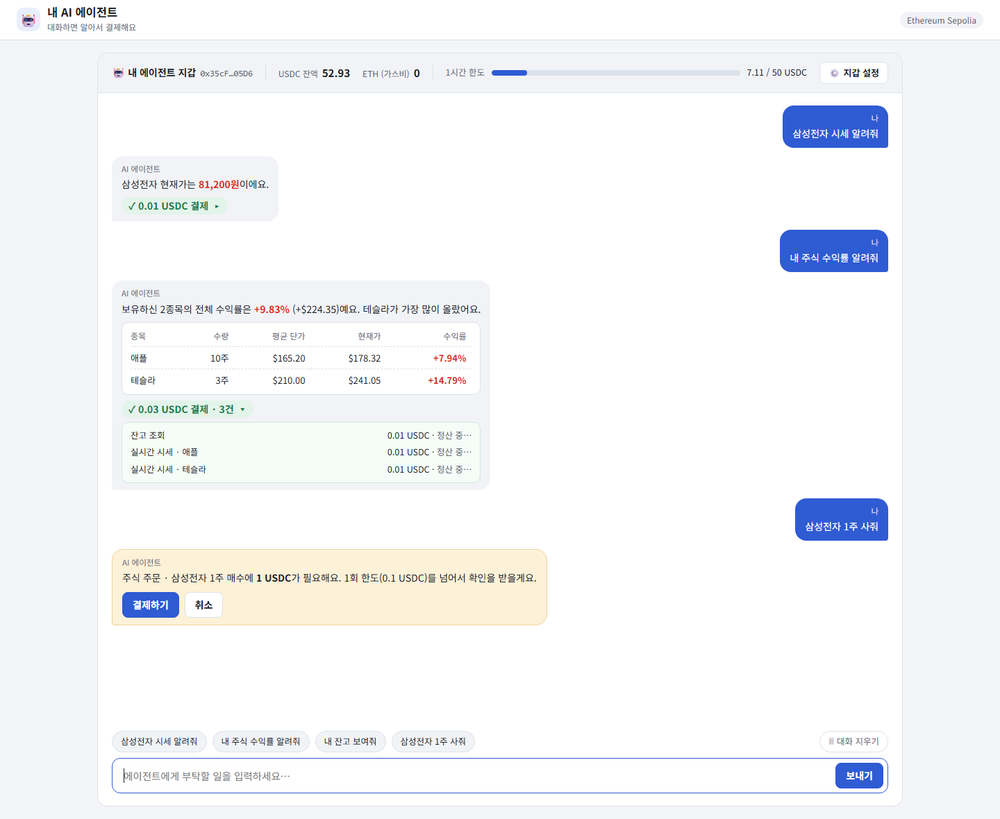
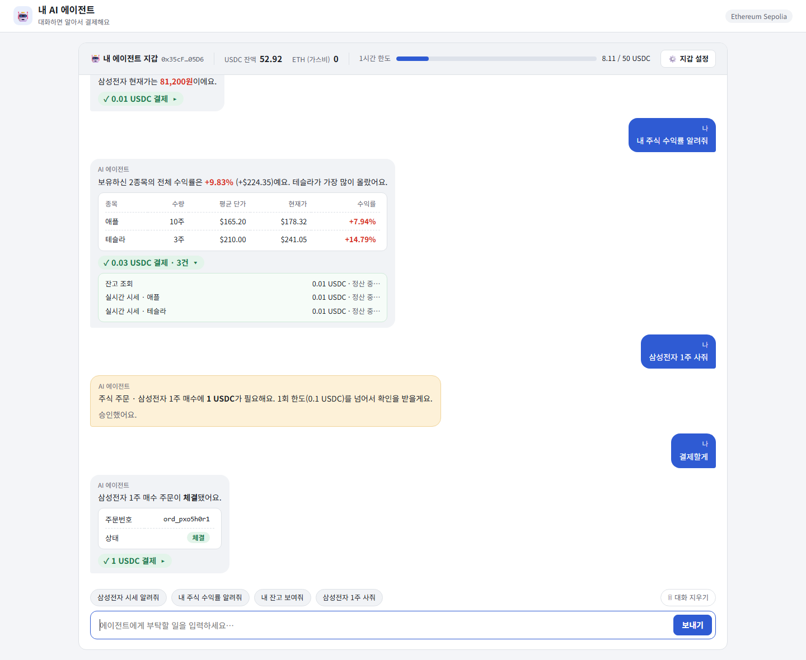
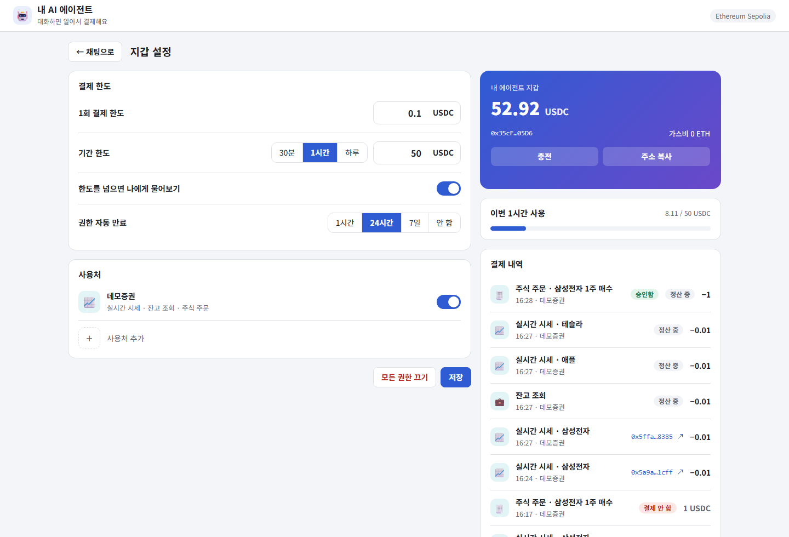
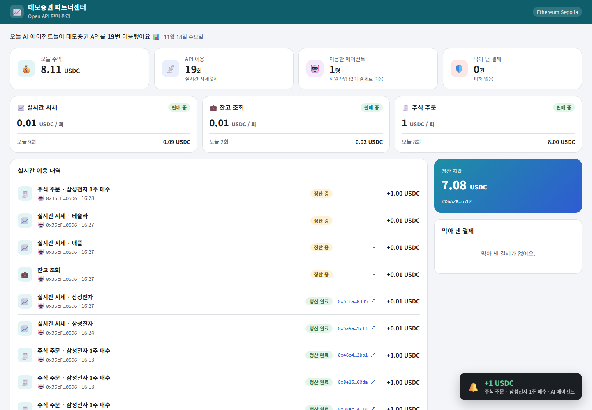

# demo-ui: AI 에이전트 결제 데모

AI 에이전트가 사용자 대신 유료 API(데모증권)를 이용하고, 이용료를 **위임받은 한도 안에서 USDC로 자동 결제**하는 과정을 보여 주는 화면입니다. 결제는 x402 방식(HTTP 402 → 지갑 서명 → 재요청)으로 이루어지고, Ethereum Sepolia 테스트넷에서 실제로 정산됩니다.

`npm start` 한 번으로 Facilitator, Resource Server, Agent Wallet과 화면 서버가 함께 뜹니다.

---

## 화면 구성

| 주소 | 화면 | 누구의 시점 |
|---|---|---|
| http://localhost:4000/agent | **에이전트 채팅** | 사용자 |
| http://localhost:4000/agent/wallet | **지갑 설정** (채팅 상단의 [⚙️ 지갑 설정]으로 이동) | 사용자 |
| http://localhost:4000/seller | **데모증권 파트너센터** | 판매자 (API 제공자) |
| http://localhost:4000/ | 개발자용 화면 (결제 단계별 실행, 공격 시나리오, 서비스 로그) | 개발자 |

시연할 때는 브라우저 창 두 개에 `/agent`와 `/seller`를 나란히 띄우면, 채팅에서 결제하는 순간 판매자 화면에 입금 알림이 뜨는 걸 함께 보여 줄 수 있습니다.

### 에이전트 채팅 (`/agent`)
문장으로 부탁하면 에이전트가 데모증권 API를 호출하고 이용료를 직접 결제합니다.



> 시세 조회는 0.01 USDC를 자동 결제하고, 수익률 질문에는 잔고 1번과 시세 2번을 사서 답합니다(배지를 펼친 상태). 1 USDC짜리 주문은 1회 한도(0.1 USDC)를 넘어서 승인 카드가 뜹니다. 에이전트 지갑의 ETH는 0입니다.

[결제하기]를 누르면 그 한 건만 결제되고 주문이 체결됩니다.



| 이렇게 말하면 | 일어나는 결제 |
|---|---|
| "삼성전자 시세 알려줘" (애플, 테슬라도 가능) | 실시간 시세 1회 (0.01 USDC) |
| "내 잔고 보여줘" (보유 종목·포트폴리오) | 잔고 조회 1회 (0.01 USDC) |
| "내 주식 수익률 알려줘" | 잔고 조회 1회 + 보유 종목 시세 2회 = **3회** |
| "삼성전자 1주 사줘" ("2주 팔아줘"도 가능) | 주식 주문 1회 (1 USDC) → 1회 한도를 넘어서 **승인 요청** |

- 답변 아래 "✓ 0.03 USDC 결제" 배지를 누르면 건별 금액과 Etherscan 트랜잭션 링크가 보입니다.
- 위쪽 줄에 에이전트 지갑 주소, USDC 잔액, **ETH 0**(가스비를 내지 않음), 한도 사용량이 표시됩니다.
- **[🗑 대화 지우기]**: 두 번 누르면 대화가 지워집니다(결제 기록은 남음).
- 에이전트는 정해진 규칙으로 문장을 해석합니다(LLM 아님). 위 표의 표현 위주로 말해야 알아듣고, 이전 대화를 기억하지 않습니다.
- "지갑에 USDC 얼마 있어?" 같은 지갑 잔액 질문은 아직 지원하지 않습니다. 잔액은 위쪽 줄에 항상 보입니다.

### 지갑 설정 (`/agent/wallet`)



- **결제 한도**: 1회 한도, 기간 한도(30분/1시간/하루), "한도를 넘으면 나에게 물어보기", 권한 자동 만료
- **사용처**: 데모증권 켜기/끄기 (끄면 에이전트가 데모증권에 결제하지 못함)
- **[모든 권한 끄기]**: 위임을 철회해서 어떤 결제도 할 수 없게 함
- **지갑 카드**: 잔액, [충전](USDC일 때 주소를 복사하고 Circle faucet을 엶), [주소 복사]
- **결제 내역**: 자동 결제, 승인한 결제, 거절한 결제, 결제하지 않은 요청

설정을 저장하면 Agent Wallet에 위임 정책이 다시 발급됩니다.

### 데모증권 파트너센터 (`/seller`)



> 채팅에서 승인한 주문이 맨 위에 "정산 중"으로 들어오고, 오른쪽 아래에 "+1 USDC" 알림이 뜬 순간입니다. 정산이 끝나면 "정산 완료"와 트랜잭션 링크로 바뀝니다.

- 오늘 수익, API 이용 횟수, 이용한 에이전트 수, 막아 낸 결제
- API 상품별 가격과 오늘 이용 횟수·수익 (가격은 Resource Server의 402 응답에서 읽어 옴)
- 실시간 이용 내역: 정산 중 → 정산 완료(트랜잭션 링크)
- 정산 지갑(결제를 받는 주소)의 잔액
- 막아 낸 결제: 재사용·위조된 결제. 채팅에서는 공격이 일어나지 않으므로, 개발자용 화면(`/`)의 공격 버튼으로 채울 수 있습니다.
- 새 결제가 들어오면 오른쪽 아래에 "🔔 +0.01 USDC" 알림이 뜹니다.

### 결제 한도 규칙
| 한도 | 넘으면 |
|---|---|
| **1회 한도** | "한도를 넘으면 나에게 물어보기"가 켜져 있으면 채팅에 [결제하기]/[취소] 카드가 뜹니다. 승인하면 **그 한 건만** 결제됩니다. |
| **기간 한도** | **승인 여부와 상관없이 거절**합니다. 승인한 결제도 사용량에 포함되고, 설정을 저장하거나 서버를 재시작해도 사용량은 초기화되지 않습니다. |

---

## 빠른 시작

### 1. 준비물
- **Node.js 22.9 이상** (`node -v`로 확인)
- **Sepolia ETH가 조금 있는 계정 1개**: Facilitator가 정산 가스비를 냅니다. 0.05 ETH면 수백 건 정산할 수 있습니다.
- 에이전트에게 넣을 **Sepolia USDC**: [Circle 테스트넷 faucet](https://faucet.circle.com)에서 무료로 받습니다(3단계 참고).
- 포트 4000~4003이 비어 있어야 합니다.

### 2. 설치 (처음 한 번)
저장소 루트에서 실행합니다. `x402-contracts`는 다른 패키지가 쓰는 공용 타입이라 먼저 빌드해야 합니다.

```bash
cd x402-contracts && npm install && npm run build && cd ..
cd facilitator    && npm install && cd ..
cd resourceServer && npm install && cd ..
cd agentWallet    && npm install && cd ..
```

`demo-ui`는 외부 패키지가 없어서 설치할 것이 없습니다.

### 3. 키 설정
```bash
cd demo-ui
cp .env.example .env    # Windows PowerShell: Copy-Item .env.example .env
```
`.env`를 열어 아래 [필요한 키와 계정](#필요한-키와-계정)을 채웁니다. **최소한 `FACILITATOR_PRIVATE_KEY` 하나**만 있으면 됩니다.

> ⚠️ 키는 반드시 `.env`에 넣으세요. `.env.example`은 git에 올라가는 견본 파일입니다.

### 4. 실행
```bash
cd demo-ui
npm start
```
터미널에 이런 줄이 나오면 준비된 것입니다.
```
Payment token: USDC (USDC, EIP-712 version "2") 0x1c7D…7238
  Agent:     http://localhost:4000/agent
  Seller:    http://localhost:4000/seller
  Agent wallet: 0x…        ← 에이전트 주소 (처음 실행할 때 자동 생성)
  Settler:      0x…        ← Facilitator 정산 주소
```
`Ctrl+C`로 전부 종료합니다. 서비스 로그는 `demo-ui/logs/`에 쌓입니다.

### 5. 에이전트 지갑에 USDC 넣기
1. `/agent/wallet`에서 **[충전]** 을 누르면 에이전트 주소가 복사되고 Circle faucet이 열립니다.
2. faucet에서 **USDC**, 네트워크 **Ethereum Sepolia**를 고르고 주소를 붙여 넣습니다.
3. 잠시 후 지갑 카드에 USDC 잔액이 보이면 채팅에서 결제할 수 있습니다.

에이전트에게는 **ETH가 필요 없습니다.** 가스비는 Facilitator가 냅니다.

### 6. 해 볼 것 (시연 순서 예시)
1. `/agent/wallet`: 한도(1회 0.1 · 1시간 0.5 USDC)를 확인
2. `/agent`와 `/seller`를 나란히 띄우기
3. "삼성전자 시세 알려줘" → 판매자 화면에 +0.01 USDC
4. "내 주식 수익률 알려줘" → 결제 3건이 연달아 들어옴
5. "삼성전자 1주 사줘" → 승인 요청 → [결제하기] → +1 USDC (기간 한도가 남아 있어야 함)
6. 결제 배지를 펼쳐 Etherscan에서 트랜잭션 확인 (보낸 사람이 Facilitator, 에이전트 ETH는 0)

---

## 필요한 키와 계정

결제에는 세 계정이 등장합니다. **`.env`에 넣는 개인키는 Facilitator 키 하나뿐**입니다.

| 역할 | 하는 일 | `.env` | 필요한 잔액 |
|---|---|---|---|
| **Facilitator** (정산) | 에이전트의 서명으로 송금을 실행하고 **가스비를 냄** | `FACILITATOR_PRIVATE_KEY` (**필수**) | Sepolia ETH |
| **에이전트** (결제자) | 결제 서명만 함 | 없음. 처음 실행할 때 Agent Wallet이 **키만** 만들어 `demo-ui/.keystore/`에 암호화해 보관 | USDC: **0에서 시작하므로 직접 넣어야 함** ([5단계](#5-에이전트-지갑에-usdc-넣기), faucet) |
| **판매자** (데모증권) | 결제를 받음 | `PAY_TO_ADDRESS` (**주소만**, 키 불필요) | 없음 |

결제 한 건의 흐름:
```
에이전트 ──서명── "0.01 USDC를 판매자에게 보내도 좋다"
   ↓
Facilitator ──그 서명으로 송금 실행 + 가스비 지불──▶ Sepolia
   ↓
USDC 이동: 에이전트 → 판매자 (Facilitator를 거치지 않음)
```

### `.env` 항목
| 항목 | 필수 | 설명 |
|---|---|---|
| `FACILITATOR_PRIVATE_KEY` | ✅ | 정산 계정의 개인키. MetaMask에서 복사한 그대로(`0x` 없이) 넣어도 됩니다. 없으면 결제 검증과 API 응답은 되지만 **블록체인 정산이 되지 않습니다.** |
| `PAY_TO_ADDRESS` | 권장 | 판매자 주소. 비우면 DemoCoin 소유자 주소(`0x0E79…beBE`)로 받습니다. 판매자 화면에서 수익이 0부터 늘어나는 걸 보려면 **새 주소**를 넣으세요. |
| `TOKEN_ADDRESS` | | 결제 토큰 주소. **비우면 USDC.** [아래](#결제-토큰-demo-대신-usdc를-쓰는-이유) 참고 |
| `TOKEN_OWNER_PRIVATE_KEY` | | DemoCoin을 쓸 때만: [충전] 버튼이 에이전트에게 1 DEMO를 보낼 계정의 키 |
| `ETHEREUM_RPC_URL` | | Sepolia RPC. 비우면 공용 노드(속도 제한 있음) |
| `APPROVAL_TOKEN_SECRET`, `KEYSTORE_PASSPHRASE` | | Agent Wallet 내부 비밀값. 비우면 개발용 기본값을 씁니다. |

### 키를 다룰 때 주의할 점
- 키는 `.env`(git 제외)에만 넣고, 채팅·메신저에 붙여 넣지 마세요. **테스트 전용 계정**을 쓰세요.
- `demo-ui/.keystore/`의 에이전트 키는 암호화돼 있지만, `KEYSTORE_PASSPHRASE`를 비워 두면 공개된 기본 암호로 암호화됩니다. 이 폴더도 키처럼 다루세요(git에서는 제외돼 있음).
- `.keystore`를 지우면 다음 실행 때 **새 에이전트 지갑**이 만들어집니다. 이전 지갑에 남은 USDC는 그 주소에 그대로 있고, 키를 지우면 꺼낼 수 없습니다.
- `KEYSTORE_PASSPHRASE`를 바꾸면 기존 `.keystore`를 읽을 수 없게 됩니다.

---

## 결제 토큰: DEMO 대신 USDC를 쓰는 이유

이 프로젝트는 원래 자체 발행한 **DemoCoin(DEMO)** 으로 결제하도록 만들어졌습니다. 지금은 **Circle의 Sepolia 테스트넷 USDC**를 기본으로 씁니다.

| | DemoCoin (DEMO) | Sepolia USDC |
|---|---|---|
| 주소 | `0x025311Ca250150E9c3684b614566c9f187a47e16` | `0x1c7D4B196Cb0C7B01d743Fbc6116a902379C7238` |
| 발행 | 이 프로젝트가 직접 배포. 전량이 소유자 `0x0E79…beBE`에게 있음 | Circle |
| 에이전트에게 넣는 방법 | **소유자 키를 가진 사람만** 보낼 수 있음 | 누구나 [faucet](https://faucet.circle.com)에서 받음 |
| EIP-3009 (`transferWithAuthorization`) | ✅ | ✅ |
| 서명 도메인 (이름 / 버전) | `DemoCoin` / `1` | `USDC` / `2` |
| 소수점 | 6자리 | 6자리 (가격 그대로) |

USDC로 바꾼 이유:
1. **누구나 테스트할 수 있습니다.** DEMO는 배포한 소유자 계정만 나눠 줄 수 있어서, 그 키가 없는 사람은 에이전트를 충전할 수 없었습니다. USDC는 faucet에서 바로 받습니다.
2. **x402 표준에 더 가깝습니다.** x402 스펙의 기준 결제 자산이 USDC이고, 원래 계획(PLAN.md 6.2)도 USDC 코드였습니다. DEMO는 Circle USDC 코드가 Sepolia의 트랜잭션 가스 상한을 넘어 배포되지 않아서 대신 만든 경량 토큰입니다.
3. **발표에서 이해하기 쉽습니다.** "자체 코인"보다 "스테이블코인(USDC)으로 결제한다"가 더 와닿습니다.

### 토큰을 바꾸는 방법
`.env`의 `TOKEN_ADDRESS`만 바꾸고 재시작하면 됩니다. 토큰 이름, 서명 도메인 버전, 심볼, 소수점은 서버가 시작할 때 **컨트랙트에서 직접 읽어** 세 서비스에 넘깁니다. 화면과 로그의 금액 단위도 자동으로 바뀝니다.

```ini
TOKEN_ADDRESS=                                            # USDC (기본)
TOKEN_ADDRESS=0x025311Ca250150E9c3684b614566c9f187a47e16   # DemoCoin
```

DemoCoin으로 돌아갈 때는:
- 에이전트를 충전하려면 `TOKEN_OWNER_PRIVATE_KEY`에 DEMO를 가진 계정의 키와 [Foundry](https://getfoundry.sh)의 `cast`가 필요합니다.
- 토큰이 섞이지 않도록 `demo-ui/data/`를 지우세요.
- `e2e/` 테스트는 아직 DemoCoin 기준입니다(USDC로는 동작하지 않음).

EIP-3009를 지원하는 다른 Sepolia 토큰도 주소만 넣으면 쓸 수 있습니다.

---

## 데이터와 초기화

| 무엇 | 어디에 | 초기화 방법 |
|---|---|---|
| 채팅 대화 | 브라우저 `sessionStorage` (탭마다 따로, 탭을 닫으면 사라짐) | 채팅의 [🗑 대화 지우기] |
| 결제 기록 (판매자 화면, 지갑 결제 내역, 기간 한도 사용량) | `demo-ui/data/ledger.json` | 서버를 멈추고 파일 삭제 |
| 지갑 설정 (한도, 사용처 등) | `demo-ui/data/agent-settings.json` | 서버를 멈추고 파일 삭제 (기본값으로 돌아감) |
| 에이전트 키 | `demo-ui/.keystore/` | 삭제하면 새 에이전트 지갑 생성 (위 주의 참고) |

판매자 화면과 결제 기록은 서비스들이 남기는 로그(결제 수신·검증·정산·차단)로 만듭니다. 그래서 개발자용 화면에서 한 결제와 공격도 함께 집계됩니다.

---

## 문제 해결

| 증상 | 원인과 해결 |
|---|---|
| 채팅에서 "결제가 거부됐어요. 지갑의 USDC가 부족해요" | 에이전트에게 USDC가 없습니다. 5단계대로 faucet에서 받으세요. |
| "1시간 한도 … 중 … 를 이미 써서 결제할 수 없어요" | 기간 한도에 걸렸습니다. 지갑 설정에서 한도를 올리거나, 시간이 지나길 기다리거나, `data/ledger.json`을 지우세요. |
| 결제는 되는데 "정산 실패" / 정산 화면 상단에 경고 | `FACILITATOR_PRIVATE_KEY`가 없거나 그 계정에 Sepolia ETH가 없습니다. |
| "데모증권이 사용처에서 꺼져 있어요" / "결제 권한이 꺼져 있어요" | 지갑 설정에서 사용처나 권한을 다시 켜고 저장하세요. |
| `port 400x … is already in use` | 이전에 띄운 서버가 남아 있습니다. 종료하고 다시 실행하세요. |
| `… did not become healthy` | 서비스 하나가 시작하지 못했습니다. `demo-ui/logs/<서비스>.log`를 확인하세요(대개 `npm install` 누락이나 `x402-contracts` 빌드 누락). |
| `bad option: --env-file-if-exists` | Node 버전이 낮습니다. 22.9 이상이 필요합니다. |
| Windows에서 `esbuild.exe … Application Control policy has blocked this file` | 회사 PC의 앱 실행 정책이 특정 폴더의 esbuild를 막은 경우입니다. 허용되는 다른 폴더의 `esbuild.exe` 경로를 `ESBUILD_BINARY_PATH` 환경 변수로 지정하고 실행하세요. |
| 승인 카드의 [결제하기]가 "이미 처리된 승인 요청" | 서버를 재시작하면 대기 중이던 승인 요청이 사라집니다. 같은 요청을 다시 하세요. |

---

## 구조

```
demo-ui/
├─ server.mjs        화면 서버 + 세 서비스 실행. 외부 패키지 없음
├─ agent.html        /agent         에이전트 채팅
├─ wallet.html       /agent/wallet  지갑 설정
├─ seller.html       /seller        데모증권 파트너센터
├─ index.html        /              개발자용 화면
├─ app.css           세 화면 공통 스타일
├─ log-format.mjs    서비스 로그를 한 줄 설명으로 변환
├─ docs/images/      README 화면 캡처
├─ .env.example      키 설정 견본 (.env로 복사해서 사용)
├─ data/             결제 기록·지갑 설정 (자동 생성, git 제외)
├─ .keystore/        에이전트 키 (자동 생성, git 제외)
└─ logs/             서비스 로그 (git 제외)
```

`server.mjs`가 하는 일:
- Facilitator(4001), Resource Server(4002), Agent Wallet(4003)을 띄우고 토큰 정보와 키를 환경 변수로 넘깁니다.
- 에이전트의 결제 한 건(402 → 지갑 서명 → `X-PAYMENT` 재요청)을 대신 수행하고, 기간 한도를 검사합니다.
- 1회 한도를 넘는 결제를 사용자가 승인하면, 그 결제만 허용하는 1분짜리 위임을 Agent Wallet에 따로 발급했다가 서명 직후 회수합니다. 기존 위임 정책은 그대로입니다.
- 서비스 로그로 결제 기록을 만들고, 잔액과 정산 트랜잭션은 Sepolia RPC로 조회합니다.

개발자용 화면(`/`)의 시연 방법은 [DEMO_GUIDE.md](DEMO_GUIDE.md)에 있습니다. 이 가이드는 DemoCoin 기준으로 작성되어 있어서, USDC로 실행하면 화면의 "DEMO"가 "USDC"로 표시되고 충전은 faucet으로 합니다.
